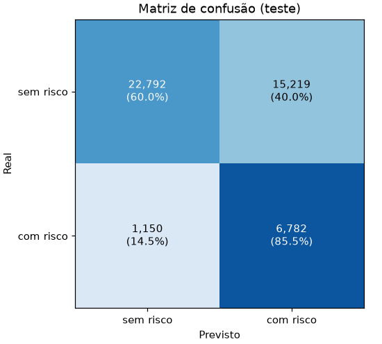
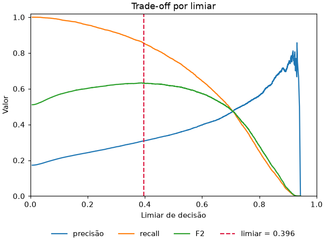
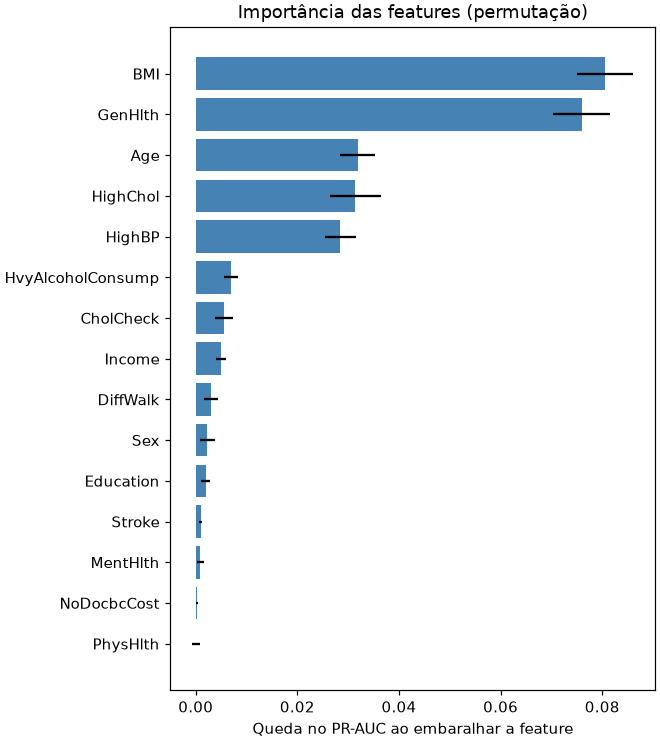
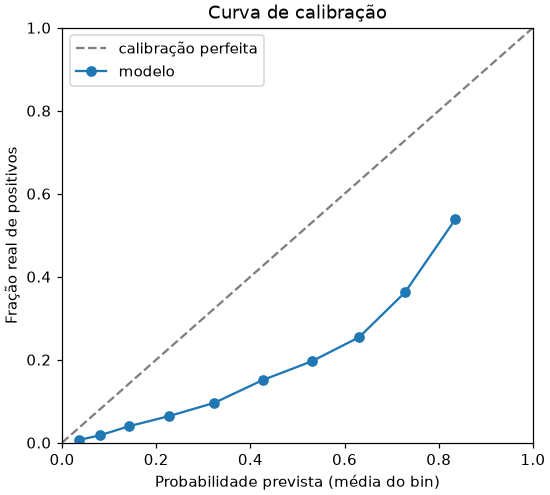

# Diabetes Risk — pipeline de ML (BRFSS 2015)

Pipeline reproduzível de triagem de **risco de pré-diabetes/diabetes** a partir
dos indicadores de saúde da pesquisa
[BRFSS 2015 (CDC)](https://www.kaggle.com/datasets/alexteboul/diabetes-health-indicators-dataset).
Cobre do CSV bruto até uma API REST, com validação de dados, rastreamento de
experimentos e Model Registry no MLflow, quality gate, Docker Compose e CI.

## Resultados (teste hold-out, 20%)

| Métrica | Valor | Como ler |
|---|---|---|
| ROC-AUC | 0,810 | em 81% dos pares (doente, saudável), o doente recebe risco maior |
| PR-AUC | 0,466 | 2,7× melhor que o acaso (prevalência de 17,3%) |
| Recall | 0,855 | de cada 100 casos, 86 são sinalizados |
| Precisão | 0,308 | de cada 100 alertas, 31 são casos reais |
| VPN | 0,952 | quando diz "sem risco", acerta 95% das vezes |
| A cada 1.000 triados | 479 alertas · 25 casos perdidos | impacto operacional |

O limiar de decisão (≈0,40) é escolhido no treino, via validação cruzada,
para maximizar a F2: em triagem, deixar passar um caso é mais caro que um
alerta extra. Relatório completo: [reports/metrics_report.md](reports/metrics_report.md).

| | |
|---|---|
|  |  |
|  |  |

## Arquitetura

```
CSV bruto ─► prepare ─► train ──────► evaluate ─────────► ModelBundle ─► API (FastAPI)
             │          │              │
             Pandera    CV + limiar    métricas, relatório, gráficos, quality gate
             dedup      ótimo          │
             split      │              ▼
                        └──────► MLflow: run único (cv/* + test/*), datasets,
                                 modelo pyfunc, Model Registry (@champion)
```

| Camada | Módulo | Responsabilidade |
|---|---|---|
| Domínio | [domain/](src/diabetes_risk/domain/) | colunas, faixas válidas, schema Pandera, *Protocols* |
| Dados | [data/](src/diabetes_risk/data/) | fontes de dados, validação, alvo binário, deduplicação, split |
| Features | [features/](src/diabetes_risk/features/) | transformer clínico + pré-processamento (sklearn) |
| Modelos | [models/](src/diabetes_risk/models/) | registry de modelos e `ModelBundle` (pipeline + limiar) |
| Avaliação | [evaluation/](src/diabetes_risk/evaluation/) | métricas, limiar ótimo, quality gate, relatório, gráficos, importância |
| Tracking | [tracking/](src/diabetes_risk/tracking/) | MLflow (ou JSON local), modelo pyfunc, linhagem |
| Monitoramento | [monitoring/](src/diabetes_risk/monitoring/) | drift por PSI |
| Etapas | [pipelines/](src/diabetes_risk/pipelines/) | orquestra as camadas: `prepare`, `train`, `evaluate` |
| Serving | [serving/](src/diabetes_risk/serving/) | API REST e contratos de entrada/saída |

### Decisões de design

- **Uma fonte de configuração**: [params.yaml](params.yaml), validado por
  Pydantic ([config.py](src/diabetes_risk/config.py)) e lido pelo DVC.
- **Sem *training-serving skew***: a engenharia de features e o pré-processamento
  vivem dentro do `Pipeline` sklearn salvo no `ModelBundle`.
- **Sem vazamento**: deduplicação antes do split; limiar escolhido com
  predições *out-of-fold*; o teste só é usado em `evaluate`.
- **SOLID**:
  - *SRP*: um módulo por responsabilidade;
  - *OCP*: novo modelo = uma função com `@register_model`;
  - *LSP*: transformers seguem o contrato sklearn;
  - *ISP/DIP*: as etapas dependem dos *Protocols* `DataSource` e
    `ExperimentTracker`, injetáveis (MLflow ou JSON local).

## MLflow: o que é registrado

Boas práticas aplicadas ([trackers.py](src/diabetes_risk/tracking/trackers.py)):

| Prática | Como |
|---|---|
| **Um run por modelo** | `train` cria o run e grava o `run_id` no bundle; `evaluate` o retoma |
| **Métricas agrupadas** | `cv/*` (validação cruzada, com `*_std` entre folds) e `test/*` (hold-out) |
| **Métricas interpretáveis** | além de AUCs: `pr_auc_lift`, `brier_skill`, `specificity`, `npv`, `alerts_per_1000`, `missed_cases_per_1000`, `false_alarms_per_1000` |
| **Relatório em linguagem natural** | vira a descrição do run ([exemplo](reports/metrics_report.md)) |
| **Gráficos** | matriz de confusão, ROC, PR, trade-off por limiar, calibração, importância por permutação |
| **Linhagem** | datasets de treino/teste com hash e schema; tag `git_commit`; parâmetros do `params.yaml` |
| **Modelo pyfunc** | *models from code*, assinatura, exemplo de entrada, dependências fixadas e **limiar embutido** (`predict` → `probability`, `at_risk`) |
| **Model Registry com aliases** | toda avaliação cria uma versão com tags; a aprovada no gate vira `@champion` (aliases substituem os *stages*, descontinuados) |

```python
model = mlflow.pyfunc.load_model("models:/diabetes-risk@champion")
model.predict(df)   # mesmo resultado da API
```

## Análise exploratória

O notebook [notebooks/01_analise_exploratoria.ipynb](notebooks/01_analise_exploratoria.ipynb)
investiga os dados antes da modelagem, com cada resultado explicado em linguagem
simples: qualidade dos dados (duplicados, rótulos conflitantes, respostas
arredondadas), distribuição do alvo, agrupamentos e fatores de risco,
correlações, perfis de pessoas (K-Means) e regras que concentram o risco
(árvore de decisão). Ele começa com um resumo executivo dos principais achados.

```bash
uv sync --all-extras --group notebooks
uv run jupyter lab notebooks/01_analise_exploratoria.ipynb
```

## Como usar

### Opção A: Docker Compose (recomendado)

Sobe MLflow (com PostgreSQL), treino e API sem instalar Python.
**Tutorial completo, incluindo atualização de imagens, rollback e backup: [docs/docker.md](docs/docker.md).**

```bash
# com o CSV em data/raw/
docker compose --profile train build
docker compose up -d --wait mlflow          # http://localhost:5000
docker compose run --rm trainer             # treina e registra no MLflow
docker compose up -d --wait api             # http://localhost:8000/docs
```

### Opção B: local com uv

Pré-requisitos: Python ≥ 3.11 e [uv](https://docs.astral.sh/uv/). Baixe
`diabetes_012_health_indicators_BRFSS2015.csv` do
[Kaggle](https://www.kaggle.com/datasets/alexteboul/diabetes-health-indicators-dataset)
para `data/raw/`.

```bash
uv sync --all-extras                # dependências + MLflow + dev tools
uv run diabetes-risk run            # prepare + train + evaluate (exit 1 se o gate reprovar)
uv run mlflow ui --backend-store-uri sqlite:///mlflow.db    # http://localhost:5000
uv run diabetes-risk serve          # http://127.0.0.1:8000/docs
```

Sem servidor, o MLflow usa `sqlite:///mlflow.db` (ver `tracking` no
`params.yaml`). Para apontar para um servidor, defina `MLFLOW_TRACKING_URI`.
Para rodar sem MLflow, use `tracking.backend: local`.

Com DVC, apenas as etapas afetadas por uma mudança são reexecutadas:

```bash
uv tool install dvc
dvc repro                           # roda só o que mudou
dvc metrics diff                    # compara métricas com o último commit
dvc plots show                      # gráficos de avaliação
```

Para trocar de modelo, edite `model.name` em `params.yaml` (`logistic_regression`,
`hist_gradient_boosting` ou `random_forest`) e rode novamente.

### Exemplo de requisição

```bash
curl -X POST localhost:8000/predict -H "Content-Type: application/json" -d '{
  "patients": [{"HighBP":1,"HighChol":1,"CholCheck":1,"BMI":38,"Smoker":1,"Stroke":0,
    "HeartDiseaseorAttack":1,"PhysActivity":0,"Fruits":0,"Veggies":1,"HvyAlcoholConsump":0,
    "AnyHealthcare":1,"NoDocbcCost":0,"GenHlth":4,"MentHlth":5,"PhysHlth":10,"DiffWalk":1,
    "Sex":1,"Age":10,"Education":4,"Income":3}]}'
```

Cada predição traz a classificação, a chance e a indicação de confirmação:

```json
{
  "probability": 0.90,
  "at_risk": true,
  "classification": "com diabetes",
  "risk_level": "alta",
  "band_prevalence": 0.50,
  "recommendation": "Chance alta de diabetes ou pré-diabetes. Procure um médico em breve para confirmar com exames laboratoriais.",
  "requires_confirmation": true,
  "confirmatory_tests": ["Glicemia de jejum", "Hemoglobina glicada (HbA1c)", "Teste oral de tolerância à glicose (TOTG), se indicado pelo médico"]
}
```

| Chance | Classificação | Score | % das pessoas (teste) | Casos reais na faixa | Indicação |
|---|---|---|---|---|---|
| Alta | com diabetes | ≥ 0,747 | 13% | 51 em 100 | exame confirmatório em breve |
| Média | com diabetes | 0,396 a 0,747 | 35% | 23 em 100 | exame confirmatório |
| Baixa | sem diabetes | < 0,396 | 52% | 5 em 100 | acompanhamento de rotina |

- **"com diabetes" inclui pré-diabetes** e é um *indicativo de triagem*: toda
  resposta positiva traz `requires_confirmation: true` e os exames que confirmam.
- Os cortes são aprendidos no treino (predições *out-of-fold*): "alta" é a faixa
  em que ao menos 50% das pessoas tinham diabetes/pré-diabetes
  (`training.high_risk_precision` no `params.yaml`).
- `band_prevalence` é mais confiável para comunicar risco do que `probability`,
  que ordena bem mas não é calibrada.
- A resposta inclui um `disclaimer`: o resultado é triagem, não diagnóstico.

### Monitorar drift

```python
from diabetes_risk.monitoring.drift import drift_report
drift_report(train_df, production_df, columns=FEATURE_COLUMNS)  # PSI > 0,25 = drift
```

## Desenvolvimento

```bash
uv run pytest                        # unitários + integração (inclui MLflow em SQLite temporário)
uv run pytest -m "not integration"   # só unitários
uv run pytest --cov                  # com cobertura
uv run ruff check src tests && uv run ruff format src tests
uv run mypy src
uv run pre-commit install            # checagens automáticas a cada commit
```

Os testes usam dados **sintéticos** gerados em
[tests/conftest.py](tests/conftest.py); não dependem do dataset real.
O CI ([.github/workflows/ci.yml](.github/workflows/ci.yml)) roda lint, mypy,
testes em Python 3.11 e 3.13 (cobertura mínima de 90%) e o build das imagens
`api`, `trainer` e `mlflow`.

## Limitações e próximos passos

- **Calibração**: `class_weight=balanced` infla as probabilidades
  (`brier_skill` ≈ −0,26). O score serve para ordenar e triar; para usá-lo como
  risco absoluto, adicione `CalibratedClassifierCV`.
- **Tuning**: hiperparâmetros fixos; Optuna pode ser plugado na etapa `train`,
  com cada trial como run aninhado no MLflow.
- **Champion vs. challenger**: hoje a versão aprovada no gate vira `@champion`;
  o próximo passo é exigir também que ela supere o champion atual.
- **Serving pelo registry**: a API lê `models/model.joblib`; pode passar a
  carregar `models:/diabetes-risk@champion` direto do MLflow.
- **Remote do DVC**: configure um (`dvc remote add`) para compartilhar dados e modelos.
- **Uso clínico**: o modelo é uma ferramenta de triagem a partir de
  autorrelato, não um diagnóstico.
